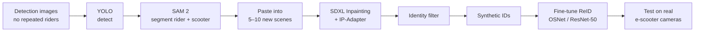

# Same Rider, New Camera

**GenAI-generated identity pairs for cross-camera re-identification of e-scooter riders**

Course project · Deep Models for Generative AI

> **Status:** proposal stage. Sections marked *planned* describe what we intend to build; results will be added as experiments run.

---

## 1. Project motivation

E-scooter riders move through streets covered by many traffic cameras. Traffic-safety analysts and city mobility teams sometimes need to find the same rider again in a different camera, for example after a crash or a hit-and-run, or when studying riding routes.

The need is growing: the U.S. Consumer Product Safety Commission reported that micromobility injuries rose 21% in 2022, and e-scooter injuries alone rose 22% (CPSC, October 2023).

Today this is done by watching hours of footage by hand, or with ReID models trained on pedestrians, cars or motorcycles, never on e-scooter riders.

## 2. Problem statement

Given a crop of an e-scooter rider from one camera, rank crops from other cameras so that **the same rider on the same scooter comes first**. The ReID model is trained **only on identity pairs generated with GenAI**, from images that never show the same rider twice.

Why it is hard:

- **No license plate.** A rider can only be matched by appearance: clothes, helmet, scooter color and shape.
- **A two-part identity.** Same rider + same scooter = same ID. If either one changes, it is a different ID.
- **No training data.** Public e-scooter datasets mark where riders are, but none show the same rider in several cameras with identity labels.

**Novelty.** Prior work re-identifies rider + vehicle pairs only with real labels (BPReID for bicycles, MoRe for motorcycles), and uses diffusion-generated ReID data only for people (DiVE, VIPerson). We add: rider + scooter identities built from detection-only images, a fair comparison of augmentation vs. copy-paste vs. diffusion, and a real e-scooter ReID test built from existing camera data.

## 3. Visual abstract


*(Figure to be added to `visuals/`.)* The pipeline in short:



## 4. Datasets used or collected

| Dataset | Contents | Role |
|---|---|---|
| ScooterDet (2024) | 2,013 images, 11,011 boxes incl. scooter and person | Source images |
| MicroVision (2026) | 8,000+ full-HD images, 30,000+ annotated road users | Source images (access to confirm) |
| E-scooter riders, Gilroy et al. (2022) | 1,130 images, 543 e-scooter riders | Source images |
| IUPUI-CSRC (2021) | 83 e-scooter rider interactions filmed by 6 cameras | **Main e-scooter ReID test** |
| UCF-VRU (2025) | 8 intersection cameras, 962 road users incl. e-scooters | Fixed-camera test (access to confirm) |
| MoRe (2021) | 3,827 motorbike + rider identities, 10 cameras | Extra transfer test |

- **Training labels** are automatic: every image generated from one source rider gets the same ID.
- **Test labels** are built by grouping existing e-scooter crops by rider, then checked by hand.
- **Split by identity:** no rider or scooter appears in both training and test. Synthetic images never enter the test set.
- Third-party datasets are **not** redistributed here. `data/` holds download scripts, split files and our own metadata; each dataset keeps its own license.

## 5. Data augmentation and generation methods

| Method | What it does | Used in |
|---|---|---|
| Standard augmentation | Crops, flips, rotation, color jitter on source images | E2 |
| Copy-paste | Cut out rider + scooter with SAM 2, paste into a new scene with simple blending | E3, E5 |
| Diffusion harmonization | SDXL Inpainting + IP-Adapter repaint only the paste edges and background (light, shadow), not the rider | E4, E5 |
| Identity filter | DINOv2 / CLIP similarity to the source + human audit of a sample; drops images where clothes or scooter changed | All synthetic sets |

**Scale (planned):** proof of concept with 20 source riders → 40–100 images; full set with 500–1,000 identities → 5,000–10,000 images.

## 6. Input / Output examples

| Input (query, camera A) | Output (ranked gallery, other cameras) |
|---|---|
| Crop of one e-scooter rider | Top-5 most similar crops; correct match = same rider on the same scooter |

Synthetic example (planned): a real source rider → mask → new street scene → generated image with the same ID label.

*(Example images and retrieval grids will be added to `visuals/`.)*

## 7. Models and pipelines used

| Step | Model / technique | Training | Alternative considered |
|---|---|---|---|
| Detect | YOLO (Ultralytics) | Fine-tuned on scooter labels | RT-DETR |
| Segment | SAM 2 (box-prompted) | None (zero-shot) | Mask R-CNN |
| Harmonize | SDXL Inpainting + IP-Adapter | Frozen; LoRA optional | Copy-paste blending |
| Filter | DINOv2 / CLIP similarity | Threshold tuned in proof of concept | Human check only |
| Re-identify | OSNet / ResNet-50 (Torchreid) | **Fine-tuned** (required trained model) | TransReID |
| Retrieve | Cosine similarity ranking | — | k-reciprocal re-ranking |

**Baselines:** frozen ImageNet / CLIP features (no ReID training); copy-paste without diffusion.

## 8. Training process and parameters

*Planned starting values; final values will be reported after tuning.*

| Component | Setting |
|---|---|
| ReID backbone | OSNet x1.0 or ResNet-50, ImageNet-pretrained |
| ReID loss | Cross-entropy (identity) + triplet loss |
| ReID optimizer | Adam, learning rate and epochs tuned on the validation split |
| ReID batches | P × K sampling (P identities × K images each) |
| Detector | YOLO fine-tuned on scooter-labeled images |
| Diffusion | SDXL Inpainting, frozen; mask limited to edges and background |
| Seeds | 3 runs per experiment, results averaged |
| Compute | Google Colab GPU |

All experiments use the same ReID model and settings; only the training data changes.

## 9. Metrics

| Level | Metric | What it shows |
|---|---|---|
| Overall | Rank-1, Rank-5 | Is the true match first, or in the top 5? |
| Overall | mAP | Quality of the whole ranking |
| Detection | mAP@0.5 | How well YOLO finds riders and scooters |
| Segmentation | Mask IoU | Accuracy on hand-checked masks |
| Generation | Identity-preservation rate | Share of generated images that keep the source identity |

**Protocol:** query and gallery always come from different cameras. **Success criterion:** E4 beats E2 by at least 3 mAP points on the real e-scooter test (mean of 3 seeds).

## 10. Results

*To be filled in as experiments run.*

| Exp. | Training data | Rank-1 | Rank-5 | mAP |
|---|---|---|---|---|
| E1 | None: frozen ImageNet features | – | – | – |
| E2 | Sources + standard augmentation | – | – | – |
| E3 | + copy-paste identity pairs | – | – | – |
| E4 | + diffusion-harmonized pairs | – | – | – |
| E5 | Copy-paste + diffusion | – | – | – |
| Ref | MoRe real labels (upper reference) | – | – | – |

## 11. Repository structure

```
├── slides/     # presentations, PPT and PDF
├── code/       # Python files and notebooks
│   ├── generation/   # detect, segment, transfer, harmonize, filter
│   ├── reid/         # ReID training and evaluation
│   └── notebooks/    # Google Colab notebooks
├── data/       # images, JSON and CSV metadata (splits, identity labels, download scripts)
├── results/    # CSV / JSON results of experiments
├── visuals/    # result figures and visual abstract
└── README.md
```

## 12. Team members

- Chen Azulay
- Shir Zehavi

---

### References

1. Yuan, Zhang, Wang. *Bike-Person Re-Identification: A Benchmark and a Comprehensive Evaluation.* IEEE Access, 2018.
2. Figueiredo et al. *MoRe: A Large-Scale Motorcycle Re-Identification Dataset.* WACV 2021.
3. *Copy and Paste Method Based on Pose for Re-Identification.* arXiv:2107.10479, 2021.
4. Li et al. *VehicleGAN: Pair-flexible Pose Guided Image Synthesis for Vehicle Re-identification.* IEEE IV 2024.
5. Dai, Lu, Li. *Diffusion-based Synthetic Data Generation for Visible-Infrared Person Re-Identification.* AAAI 2025.
6. Zhang et al. *VIPerson: Flexibly Generating Virtual Identity for Person Re-Identification.* ICCV 2025.
7. Rasch, Pai. *MicroVision: An Open Dataset and Benchmark Models for Detecting VRUs and Micromobility Vehicles.* 2026.
8. Chen et al. *Performance Evaluation of Real-Time Object Detection for Electric Scooters* (ScooterDet). arXiv:2405.03039, 2024.
9. Gilroy et al. *E-Scooter Rider Detection and Classification in Dense Urban Environments.* Results in Engineering, 2022.
10. Apurv et al. *Detection of E-scooter Riders in Naturalistic Scenes* (IUPUI-CSRC). arXiv:2111.14060, 2021.
11. *VRU-CIPI: Crossing Intention Prediction at Intersections* (UCF-VRU dataset). arXiv:2505.09935, 2025.
12. U.S. CPSC. *Micromobility Products-Related Deaths, Injuries, and Hazard Patterns.* October 2023.
